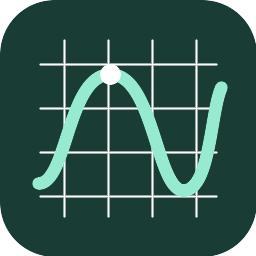

# Rust Graph



A native, offline graphing calculator for Linux, written in Rust. Inspired by the expression sidebar and interactive canvas of [Desmos](https://www.desmos.com/calculator), with an independent math engine and native desktop interface.

## What it does

- Editable colored expressions with instant graphing, visibility toggles, color selection, notes, tables, and undo/redo.
- Cartesian functions, implicit equations and inequalities, polar curves, parametric curves, and points.
- Parameters with sliders, animation, editable ranges, and steps.
- User-defined functions, piecewise expressions, domain restrictions, implicit multiplication, and radians/degrees.
- Pan and zoom, adjustable bounds, equal axis scale, grid/axes settings, and coordinate tracing.
- Point tables, automatic equation-to-table sampling, and linear, polynomial (degrees 2–6), exponential, logarithmic, power, and sinusoidal regressions.
- Native open/save dialogs, local session recovery, and PNG/SVG exports.
- Typeset radicals, fractions and powers with a bundled STIX math font, plus an on-screen math keypad.
- Turning points, intercepts and intersections with clickable coordinate markers.
- Twelve-significant-digit decimal coordinates and optional exact-style π, rational and radical forms.

## Examples

| Input | Result |
| --- | --- |
| `y=sin(x)` | Sine curve |
| `a=1` followed by `y=a*x^2` | Adjustable parabola |
| `f(u)=u^2+1` followed by `y=f(x)` | User-defined function |
| `x^2+y^2=25` | Implicit circle |
| `y<x^2-2` | Shaded inequality |
| `y=sqrt(x) {0<x<9}` | Domain restriction |
| `y={x<0:-x,x^2}` | Piecewise curve |
| `r=4*cos(3*theta)` | Polar rose |
| `(3*cos(t),2*sin(t))` | Parametric ellipse; adjust the t range |
| `(2,3)` | Point |

Use explicit `*` between named variables (`a*b`). Multiplication such as `2x`, `2(x+1)` and `x(x+1)` is supported. The editor accepts plain math and a LaTeX subset: `\sqrt{x}`, `\sqrt[3]{x}`, `\frac{a}{b}`, `x^{2}`, `\pi`, and common function commands. Click a typeset expression to edit its source. Constants: `pi`, `e`, `tau`; Unicode π and θ are accepted. Powers: `^`; factorial: `!`. Builtins include `sin`, `cos`, `tan`, `asin`, `acos`, `atan`, `atan2`, `sinh`, `cosh`, `tanh`, `sqrt`, `cbrt`, `root`, `abs`, `exp`, `ln`, `log`, `log2`, `floor`, `ceil`, `round`, `sign`, `min`, `max`, `mod`, and `pow`. `log(x)` is base 10; `log(x,b)` uses base b.

Use an expression’s **… → Generate table** menu to choose a sampling range and step. Tables accept one numeric `x,y` pair per line; choose a model and click **Fit** to add its equation. Enable **Exact values** in settings for π/radical coordinate forms. Numerically recognized forms retain an ≈ indicator; proven scalar expressions can display exact results. Click a notable point to inspect its coordinates. Right-click a row's colored circle to choose a color. Enter adds a row. Drag the graph to pan, scroll to zoom, double-click to reset. Hover near a curve to trace coordinates. Ctrl+O opens; Ctrl+S saves; Ctrl+Shift+S saves as; Ctrl+Z and Ctrl+Shift+Z undo/redo.

## Build and install

Requires Rust 1.88+ and Linux development libraries. On Ubuntu/Mint:

```sh
sudo apt install build-essential pkg-config libx11-dev libxi-dev libxrandr-dev libxcursor-dev libxkbcommon-dev libwayland-dev libgl1-mesa-dev
cargo build --release --locked
./scripts/install.sh --no-build
```

Launch **Rust Graph** from the desktop application menu or run:

```sh
~/.local/bin/rust-graph
~/.local/bin/rust-graph graph.rustgraph
```

Installation is per user and needs no administrator privileges. It installs the executable in `~/.local/bin`, the desktop entry in `~/.local/share/applications`, and the icon in `~/.local/share/icons`. Native dialogs use the desktop's XDG portal. If dialogs do not appear, ensure `xdg-desktop-portal` and a backend for your desktop are running.

Session recovery uses `$XDG_DATA_HOME/rust-graph/session.rustgraph` (normally `~/.local/share/rust-graph/session.rustgraph`). Graph files are versioned JSON. Invalid files display an error while preserving the current graph. There are no accounts, analytics or network dependencies at runtime.

## Scope and numerical limits

This is an independent calculator with a bounded numerical engine. It does not implement symbolic algebra, general list algebra, statistics distributions, arbitrary user-specified regression models, actions, image overlays, audio tracing, or cloud collaboration. Rendering uses bounded numerical sampling; very small features, very rapid oscillations, and implicit tangencies may need zooming to resolve. Inequality fills follow a sampled mesh. Coordinate tracing interpolates sampled geometry. Graphs allow 128 rows; tables allow 2048 points. Expressions have length, depth and evaluation limits so malformed or recursive formulas return errors.

## Development

```sh
cargo fmt --check
cargo clippy --all-targets -- -D warnings
cargo test --locked
```

- `src/math.rs`: tokenizer, Pratt parser, bounded evaluator.
- `src/document.rs`: versioned files, definition resolution and scene compilation.
- `src/graph.rs`: viewport transforms, curve sampling and implicit contours.
- `src/app.rs`: egui desktop UI, history, dialogs and session recovery.
- `src/export.rs`: SVG and PNG generation from shared geometry.

MIT licensed. The bundled STIX Two Math font is licensed under the SIL Open Font License; see [assets/STIX-OFL.txt](assets/STIX-OFL.txt). Not affiliated with Desmos Studio.
